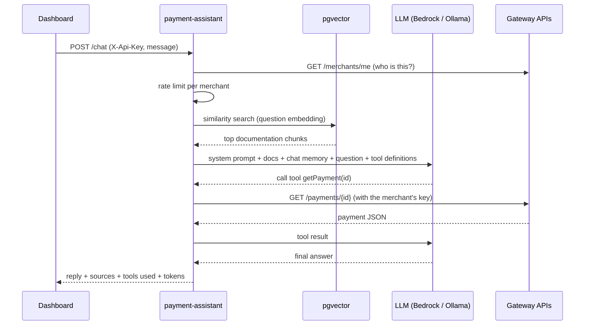

# Payment Assistant


An AI support assistant for merchants of my [Payment Gateway Simulator](https://github.com/amirizalrahmat0799/payment-gateway-sim).
Merchants ask questions in plain language in the [Merchant Dashboard](https://github.com/amirizalrahmat0799/merchant-dashboard),
such as *"why was my last payment declined?"*, *"how much will I be paid tomorrow?"* or *"what does insufficient_funds mean?"*.
The assistant answers using **their own live data** (through tool calling) and **the gateway's documentation**
(through retrieval-augmented generation).

Built with **Spring Boot 3.5 + Spring AI 1.1**. It runs on **Amazon Bedrock** (Claude Haiku 4.5 + Titan embeddings)
or on free **local models through Ollama**, switched with one Spring profile.

## How it answers a question



## Design decisions

| Concern | Decision |
|---|---|
| **Data access** | Tools call the gateway's REST APIs **with the merchant's own API key**, so the assistant can never see more than the merchant can in the dashboard. The key travels in Spring AI's `ToolContext`, which is **never sent to the model** |
| **Safety** | Tools are **read-only**: the assistant explains how to refund but can't issue one. Anything that moves money stays a human action. The system prompt tells the model to treat payment descriptions and documents as data, not instructions (prompt-injection defence) |
| **Grounding** | RAG over five markdown documents (payment lifecycle, decline reasons, fees & settlement, API & idempotency, test cards). Documents are split by `##` section so each chunk is self-contained and citable, and the answer returns its **sources** |
| **Accuracy with money** | Tools return amounts pre-formatted (`RM 150.00`) next to minor units, so the model quotes instead of calculating |
| **Memory** | Conversation memory (last 20 messages) keyed by `merchantId:conversationId`, so a merchant can't read another merchant's conversation |
| **Cost control** | Per-merchant rate limit (20 messages/minute), a 1,000-character message cap, `max-tokens` on Bedrock, and token usage returned with each reply |
| **Incremental ingestion** | Each document's SHA-256 is stored, so unchanged documents aren't re-embedded on restart (no repeated embedding cost) |
| **Provider-agnostic** | Both providers are on the classpath; `spring.ai.model.chat` / `spring.ai.model.embedding` select one per profile. Each embedding model gets its own vector table, since dimensions differ (768 vs 1024) |
| **Errors** | Model-provider errors (throttling, credentials) map to a generic 502 so internals never reach the merchant; invalid keys give 401, rate limits 429 |
| **Observability** | Actuator + Prometheus, including Spring AI's `gen_ai.client.*` token-usage and latency metrics |

## API

`POST /api/v1/assistant/chat`, header `X-Api-Key`:

```json
{ "message": "Why was my last payment declined?", "conversationId": "optional, to continue a chat" }
```

```json
{
  "conversationId": "5b1c…",
  "reply": "Your payment of RM 45.00 on 29 Sept was declined with insufficient_funds: the card didn't have enough balance…",
  "sources": [{ "title": "Decline reasons", "section": "insufficient_funds" }],
  "toolsUsed": ["listRecentPayments"],
  "totalTokens": 1432
}
```

`DELETE /api/v1/assistant/conversations/{id}` clears a conversation.

Tools available to the model: `getPayment`, `listRecentPayments`, `getRefunds`, `getPayoutSummary`, `listSettlements`.

## Running it

### With local models (free)

Start the [gateway](https://github.com/amirizalrahmat0799/payment-gateway-sim) (`docker compose up -d`), then:

```bash
docker compose up -d --build
```

This starts pgvector, Ollama and the assistant on **http://localhost:8085**. The first start downloads
`qwen2.5:3b` and `nomic-embed-text` (about 2.5 GB), so give it a few minutes (`docker compose logs -f assistant`).

Try it with [`http/assistant.http`](http/assistant.http) in IntelliJ, or from the dashboard's **Assistant** page.

> Small local models are fine for development but less reliable at tool calling than Claude. For the best
> answers, use Bedrock.

### With Amazon Bedrock

See **[docs/aws-bedrock-setup.md](docs/aws-bedrock-setup.md)**: account, budget alarm, least-privilege IAM policy,
model access and credentials. Then run with `SPRING_PROFILES_ACTIVE=aws`.

### From IntelliJ

Run `docker compose up -d assistant-db ollama`, then run `AssistantApplication` (add `aws` to active profiles
for Bedrock).

## Tests

```bash
mvn verify
```

Unit tests cover the tools (key scoping, status filters, limits, payout maths), the rate limiter, markdown
sectioning, prompt assembly, and the web layer (validation, 401/429/502 mapping). No model is needed to run them.

## Roadmap

- [ ] Stream answers token by token (SSE)
- [ ] Evaluation suite: a fixed set of questions checked for the correct tools and grounded answers (Spring AI evaluators)
- [ ] Bedrock Guardrails for PII filtering
- [ ] JDBC-backed chat memory and a Redis rate limiter for multiple replicas
- [ ] Kubernetes manifests in [payment-gateway-k8s](https://github.com/amirizalrahmat0799/payment-gateway-k8s)

## License

[MIT](LICENSE)
